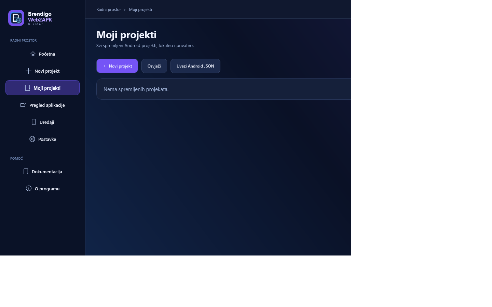
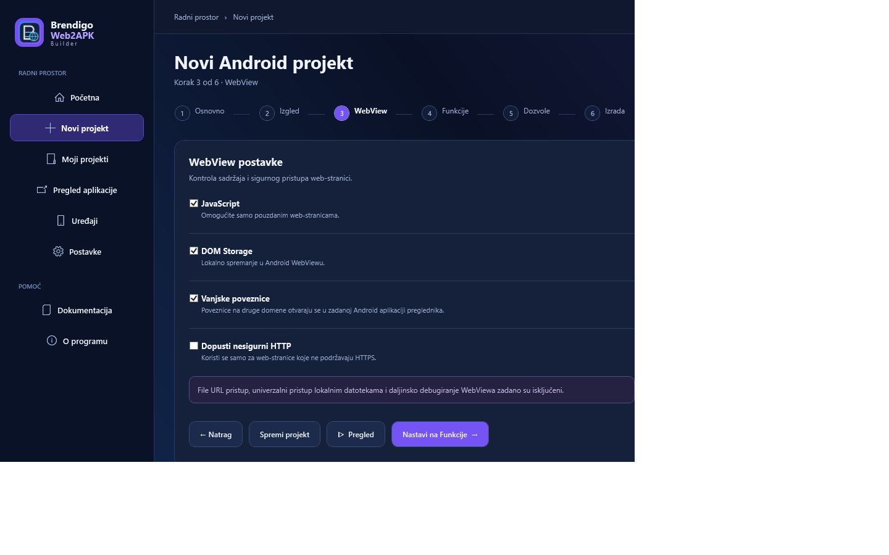
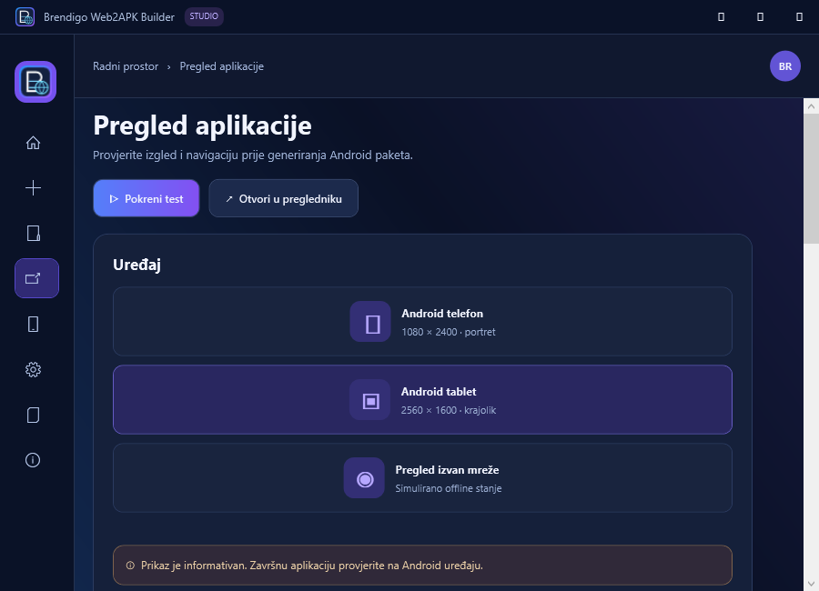
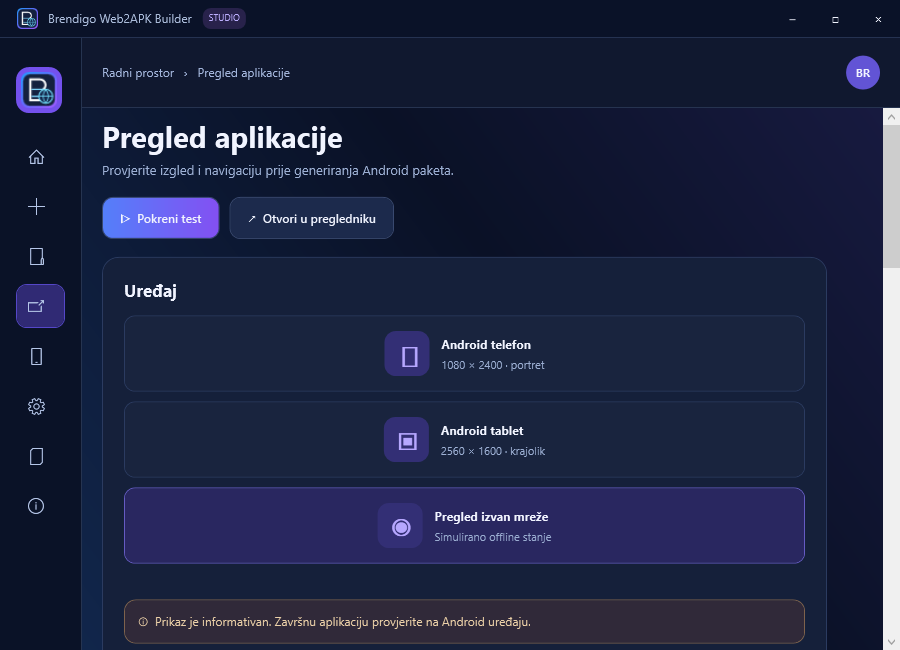
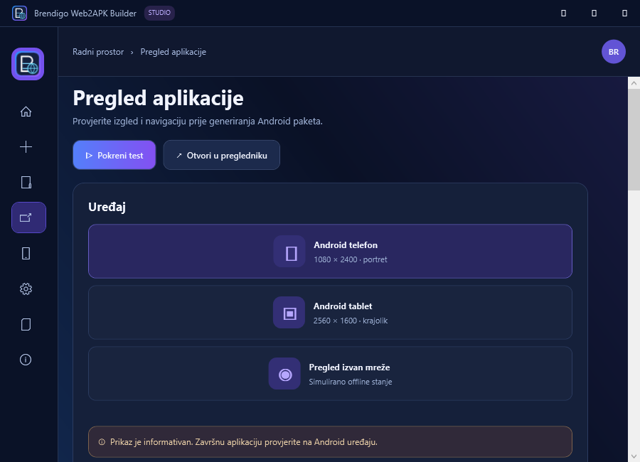
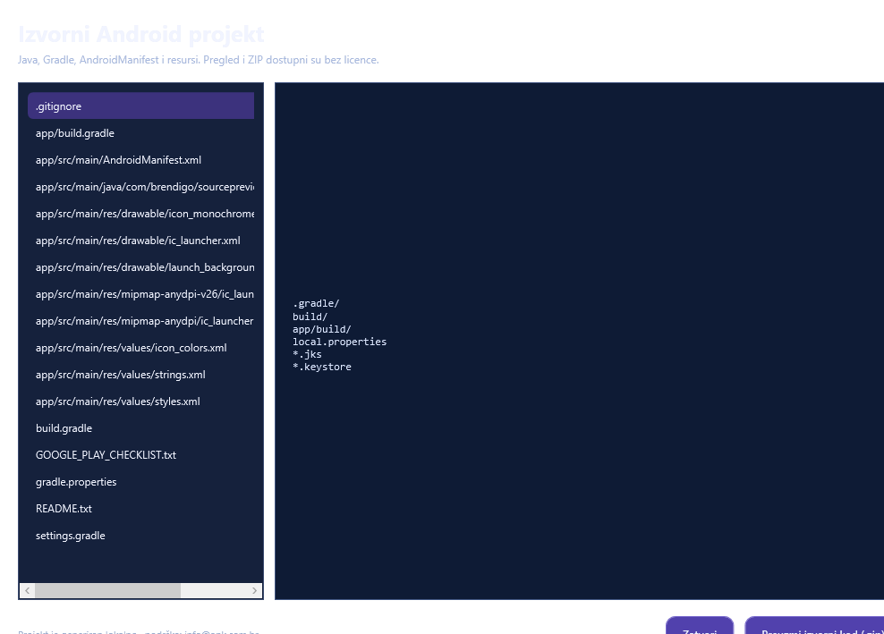
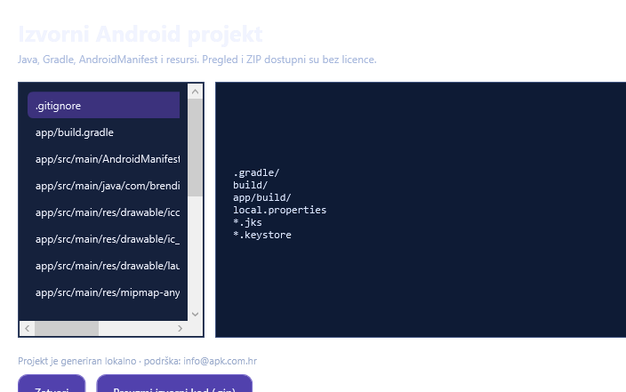
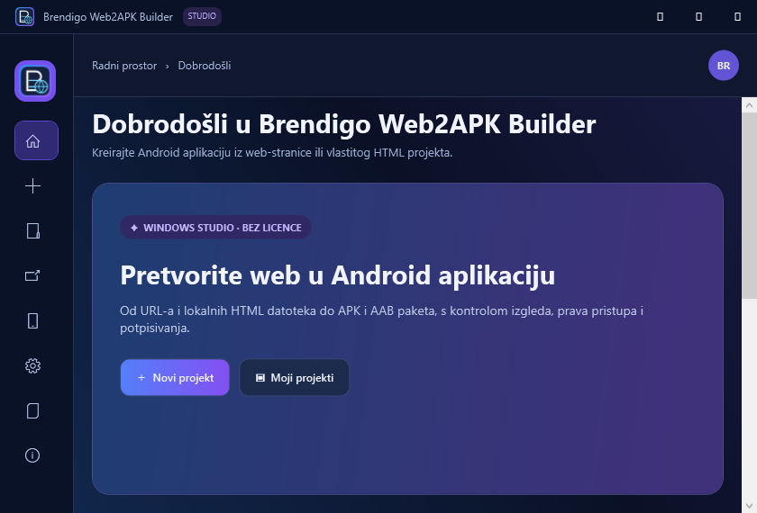
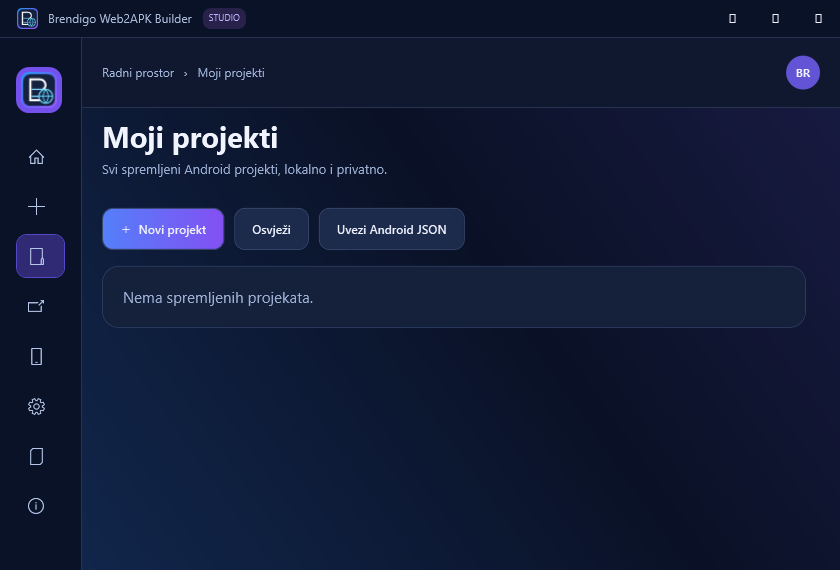
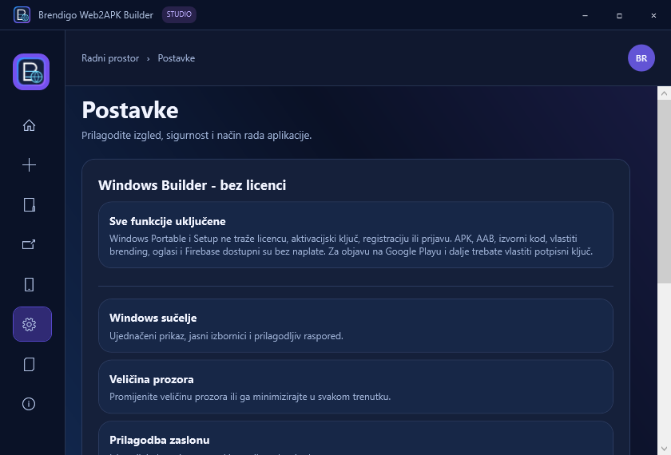

 

# Brendigo Web2APK Builder

### Vaša web-stranica zaslužuje svoju Android aplikaciju.

**Pretvorite web-stranicu ili vlastiti HTML projekt u Android APK i AAB — uz vizualno uređivanje, pregled na simuliranom uređaju i potpunu kontrolu nad brendingom.**

**Windows Portable i Setup · Bez licence · Bez registracije · Bez obveznog Android Studija**

 

[**⬇ Preuzmi najnoviju verziju**](https://github.com/bren-wp/Web2APK-Builder/releases/latest) &nbsp;·&nbsp;
[**🌐 apk.com.hr**](https://apk.com.hr) &nbsp;·&nbsp;
[**📘 Korisničke upute**](docs/KORISNICKE-UPUTE-HR.md)

 

**Izradio Brendigo** · [brendigo.com](https://brendigo.com)

---

## Od ideje do aplikacije. Sve u jednom Windows Studiju.

Web2APK Builder objedinjuje pripremu projekta, izgled aplikacije, Android dozvole, lokalnu izradu paketa i potpisivanje u jednom preglednom sučelju. Novi projekt dobiva vlastiti jedinstveni Android package ID koji je moguće prilagoditi prije objave.

| | Mogućnost | Zašto je važna |
|:--:|---|---|
| 🌐 | **Web → Android** | Povežite HTTPS web-stranicu ili dodajte lokalni HTML projekt. |
| 🎨 | **Vlastiti vizualni identitet** | Uredite naziv, ikonice, splash zaslon, boje i izgled. |
| 📱 | **Pregled prije izvoza** | Prebacujte se između telefona, tableta i prikaza bez mreže. |
| 🧩 | **Android funkcije** | Prema potrebama projekta uključite kameru, mikrofon, lokaciju, prijenos datoteka i osvježavanje. |
| 🔔 | **Firebase Push i AdMob** | Dodajte obavijesti i oglase uz vlastitu konfiguraciju i potrebne privole. |
| 🔐 | **Izrada i potpisivanje** | Izradite APK ili AAB, koristite vlastiti keystore ili generirajte lokalni ključ. |

### Upoznajte stvarni Windows Builder

Ovo su **izvorne snimke programa**, snimljene iz stvarnog Windows WPF sučelja. Slike su spremljene u repozitoriju — nisu promotivni prikazi koji glume program.

| Početni zaslon | Nadzorna ploča |
|:--:|:--:|
|  |  |
| **Moji projekti** | **Pregled Android aplikacije** |
|  |  |

## Šest koraka do APK ili AAB paketa

| 01 · Osnovne informacije | 02 · Izgled i brending |
|:--:|:--:|
|  |  |
| **03 · WebView** | **04 · Funkcionalnosti** |
|  |  |
| **05 · Dozvole i privatnost** | **06 · Izrada aplikacije** |
|  |  |

Sve promjene uređujete unutar Windows programa. Za prvi Android build potrebni alati mogu se preuzeti iz službenih izvora **uz vaše dopuštenje**; internetska veza potrebna je za početno preuzimanje.

## Pregled koji otkriva više

U Preview zaslonu možete provjeriti različite prikaze aplikacije prije izvoza. Lokalni HTML i udaljeni URL-ovi podržavaju različite načine provjere; simulacija izvanmrežnog stanja nije zamjena za testiranje stvarne mreže.

| Android tablet | Izvanmrežni prikaz | Pregled bez splasha |
|:--:|:--:|:--:|
|  |  |  |

## Preuzmite Windows Builder — bez licence

Ne morate kupiti paket, unijeti aktivacijski ključ niti otvoriti korisnički račun. **Sve mogućnosti Windows Buildera dostupne su i u Portable i u Setup verziji.**

| Verzija | Namjena | Preuzimanje |
|---|---|---|
| **Portable.exe** | Pokretanje Windows Studija bez standardne instalacije | [⬇ Brendigo-Web2APK-portable.exe](https://github.com/bren-wp/Web2APK-Builder/releases/latest/download/Brendigo-Web2APK-portable.exe) |
| **Setup.exe** | Klasična instalacija za Windows | [⬇ Brendigo-Web2APK-Setup.exe](https://github.com/bren-wp/Web2APK-Builder/releases/latest/download/Brendigo-Web2APK-Setup.exe) |

**Brzi početak:** pokrenite Studio, odaberite **Novi projekt**, dodajte adresu web-stranice ili mapu s datotekom index.html, prilagodite izgled, provjerite dozvole te u koraku **Izrada** odaberite APK, AAB ili izvorni kod.

Za izradu Android paketa potrebni su JDK, Gradle i Android SDK. Studio može pripremiti potrebne alate lokalno uz potvrdu korisnika. Za potpisanu nadogradnju na Google Playu potreban je odgovarajući privatni ključ; **debug i nepotpisani paketi nisu spremni za izravnu objavu**.

## Vaš izvorni kod. Vaša kontrola.

| Pregled izvornog koda | Prilagodljivi Windows prozor |
|:--:|:--:|
|  |  |

Pregledajte datoteke generiranog Android projekta i spremite **ZIP izvornog koda**. Za pristup nije potrebna licenca, a izvozi se lokalno. ZIP se najprije priprema kao privremena datoteka, zatim sprema pod odabranim nazivom.

## Prilagođen vašem zaslonu

Brendigo Web2APK Builder možete koristiti i u manjim prozorima. Navigacija, kartice i koraci čarobnjaka prilagođavaju se dostupnoj širini, uz okomito pomicanje dužih stranica.

| Kompaktna početna stranica | Kompaktni projekti | Kompaktne postavke |
|:--:|:--:|:--:|
|  |  |  |

**Dodatni prikazi:** [Razvojni alati](docs/screenshots/native/tools.png) · [Uređaji](docs/screenshots/native/devices.png) · [Dokumentacija](docs/screenshots/native/docs.png) · [O programu](docs/screenshots/native/about.png) · [Splash](docs/screenshots/native/splash.png).

## Brendigo License Studio

Zaseban License Studio služi za rad s postojećim **BL2 licencama Android Mobile klijenta**. Nije potreban za pokretanje ni korištenje Windows Buildera.

[⬇ License Studio Portable](https://github.com/bren-wp/Web2APK-Builder/releases/latest/download/Brendigo-LicenseStudio-portable.exe) · [⬇ License Studio Setup](https://github.com/bren-wp/Web2APK-Builder/releases/latest/download/Brendigo-LicenseStudio-Setup.exe)

[Upute za License Studio](docs/LICENSE-STUDIO-HR.md)

### Android Mobile klijent

Android klijent omogućuje pregled i uređivanje projektnih konfiguracija, lokalni prijenos JSON projekata i upravljanje zasebnim BL2 licencama. **APK i AAB aplikacije izrađuje Windows Builder**, a ne mobilni klijent. Android testni APK služi provjeri; dostupni AAB nije potpisan za produkcijsku distribuciju.

[Android testni APK](https://github.com/bren-wp/Web2APK-Builder/releases/latest/download/Brendigo-Web2APK-Android-test.apk) · [Nepotpisani Android AAB](https://github.com/bren-wp/Web2APK-Builder/releases/latest/download/Brendigo-Web2APK-Android-unsigned.aab)

## Privatnost i pouzdanost

**Lokalni projekti. Kontrola nad podacima.** Web2APK Builder čuva projektne postavke lokalno, bez obveznog računa i bez ugrađene telemetrije. Koristi sigurnosnu kopiju baze projekata i omogućuje oporavak ako je lokalna baza oštećena. Keystore i zaporke ne pohranjuju se u projektne podatke.

Android aplikacije mogu komunicirati s vašom web-stranicom te uslugama koje sami uključite (primjerice Firebase ili AdMob); za njih vrijede odgovarajuće obveze privatnosti. Pregled WebView podrijetla, dozvola i potpisa smanjuje rizike, ali ne zamjenjuje testiranje aplikacije na fizičkom uređaju i provjeru pravila Google Playa.

[**Sigurnosne informacije**](SECURITY.md) · [**Korisnički priručnik**](docs/KORISNICKE-UPUTE-HR.md) · [**Povijest izdanja**](CHANGELOG.md) · [**Sva izdanja**](https://github.com/bren-wp/Web2APK-Builder/releases)

---

**Brendigo Web2APK Builder**

Web: [apk.com.hr](https://apk.com.hr) · Podrška: [info@apk.com.hr](mailto:info@apk.com.hr) · Autor: [Brendigo](https://brendigo.com)

