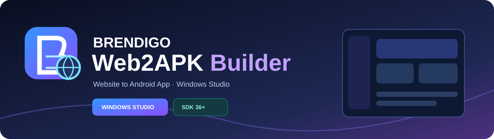
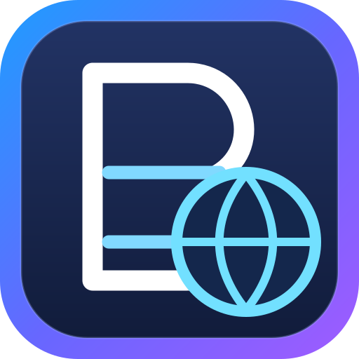
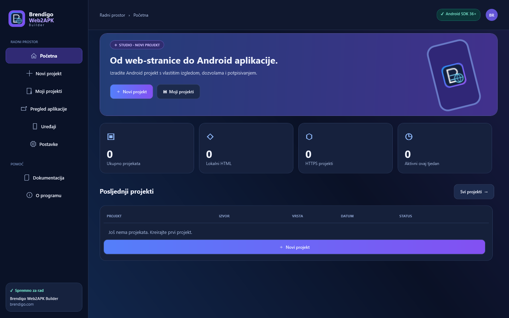
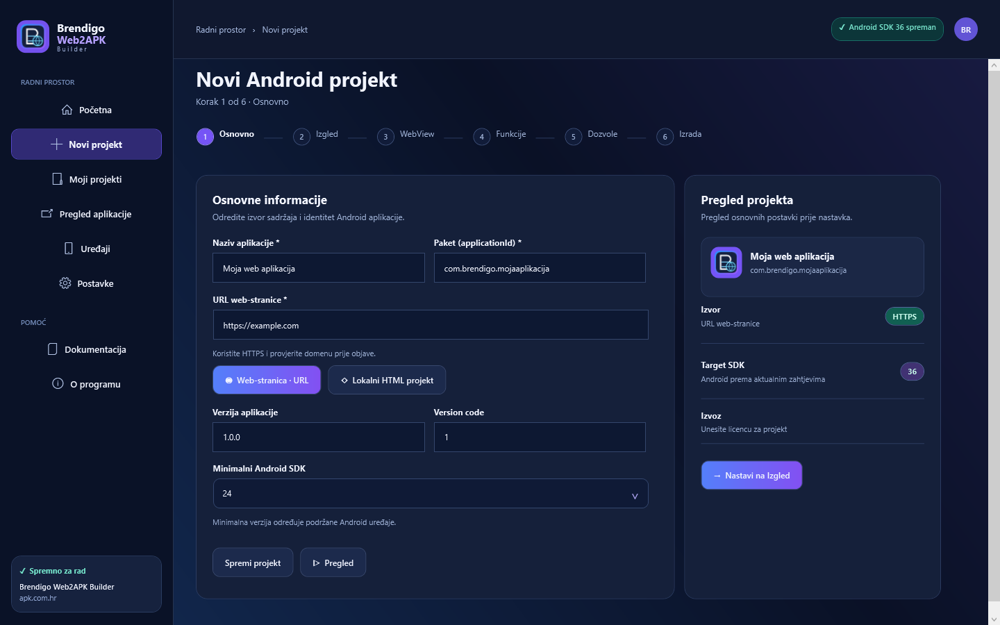
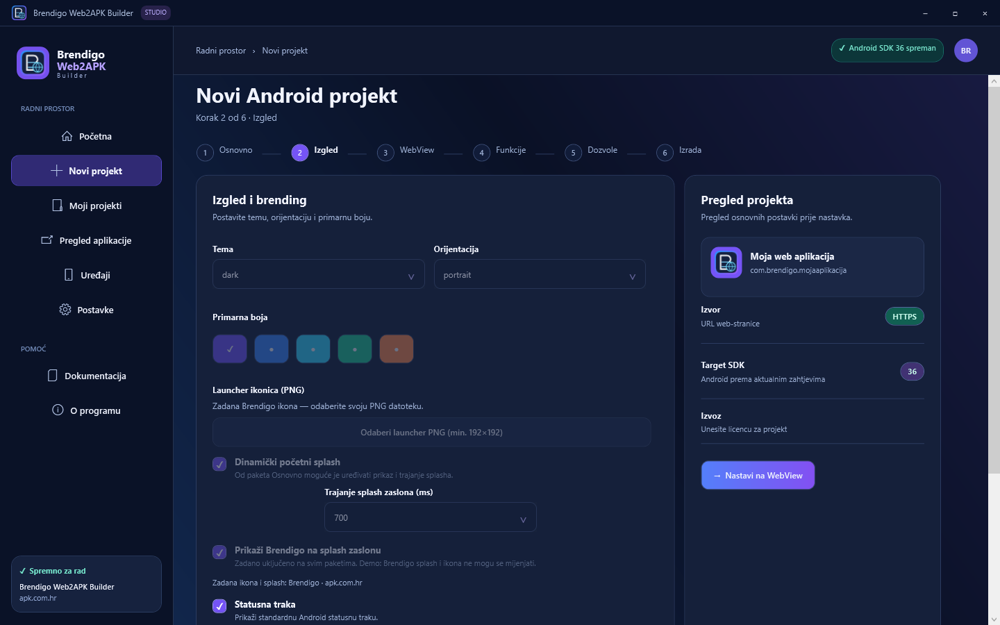
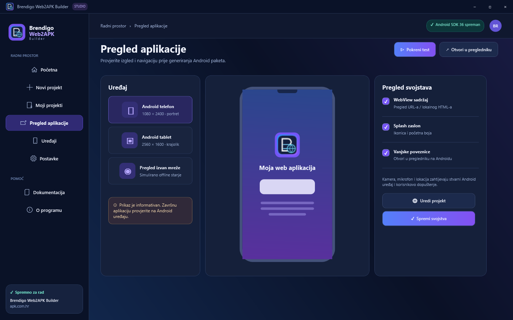
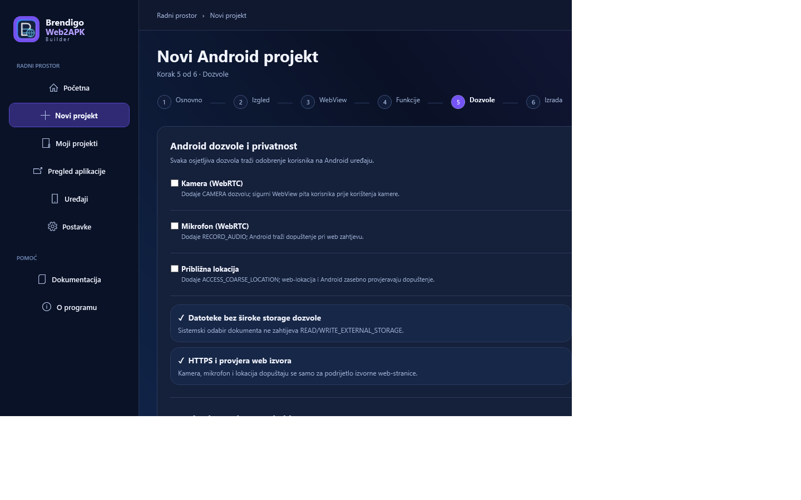
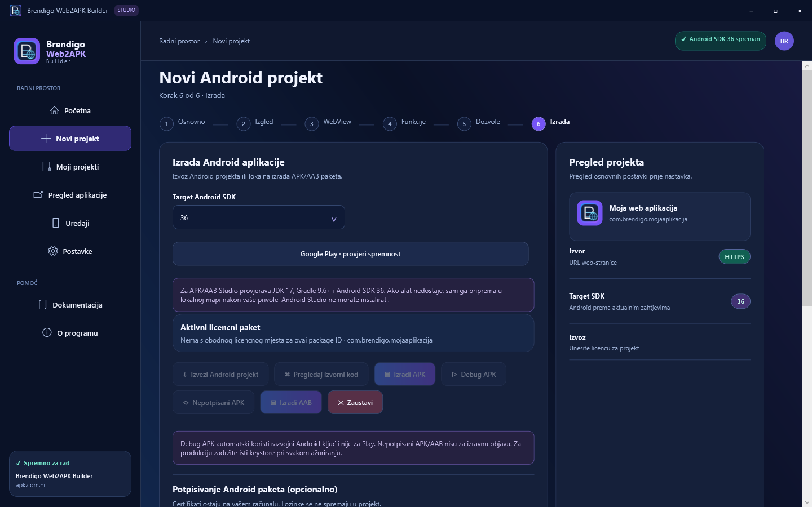
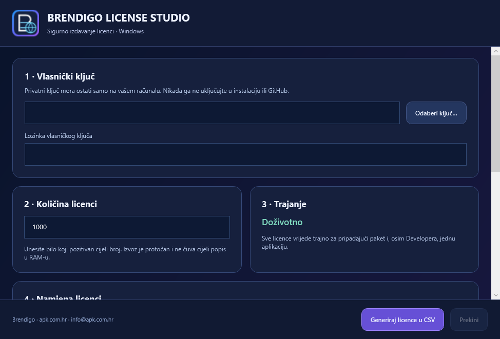

# Brendigo Web2APK Builder

### Vaša web-stranica. Vaša Android aplikacija.

**Nativni Windows Studio za stvaranje Android APK/AAB aplikacija s vlastitim identitetom, dozvolama i potpisivanjem.**

[**Preuzmi Windows Studio**](https://github.com/bren-wp/Web2APK-Builder/releases/latest) · [**Službena stranica: apk.com.hr**](https://apk.com.hr) · **Podrška: info@apk.com.hr**

Razvoj i autorstvo: **Brendigo** · [brendigo.com](https://brendigo.com)

---

## Od weba do Android aplikacije

Pretvorite HTTPS web-stranicu ili lokalni HTML projekt u Android aplikaciju. Uređujte izgled u nativnom Windows sučelju, pregledajte ponašanje, konfigurirajte dozvole i izradite APK/AAB. Vaši projekti i potpisni ključevi ostaju na vašem računalu, a web-sadržaj se otvara izravno s njegove odabrane adrese.

| U koracima | Što dobivate |
|---|---|
| **01 · Projekt** | Naziv, automatski generiran stabilan package ID, HTTPS URL ili vlastiti lokalni HTML |
| **02 · Brending** | Zadana Brendigo ikona, početni splash, boje i vlastiti PNG |
| **03 · WebView** | Sigurnosne postavke preglednika i vanjske poveznice |
| **04 · Funkcionalnosti** | AAB, datoteke, preuzimanja, Firebase Push, AdMob i osvježavanje prema paketu |
| **05 · Dozvole** | Kamera, mikrofon, lokacija, pristup datotekama i privatnost |
| **06 · Izrada** | Debug APK, nepotpisani APK/AAB ili produkcijski potpis |

### Stvarni Windows zasloni

Snimke niže nastaju **automatskim renderiranjem stvarnog nativnog WPF sučelja** tijekom GitHub Actions provjera. Nisu umjetno generirane ilustracije.

| Početna ploča | Novi projekt |
|:--:|:--:|
|  |  |
| **Brending i splash** | **Pregled Android aplikacije** |
|  |  |
| **Dozvole i privatnost** | **APK/AAB izrada** |
|  |  |

**Stvarni Brendigo License Studio:** 

**Dodatne snimke na malim prozorima:** [Početni zaslon 900 px](docs/screenshots/native/welcome-small-900.png) · [Nadzorna ploča 900 px](docs/screenshots/native/dashboard-small-900.png) · [Moji projekti 900 px](docs/screenshots/native/projects-small-900.png) · [Postavke 900 px](docs/screenshots/native/settings-small-900.png) · [Razvojni alati 900 px](docs/screenshots/native/tools-small-900.png) · [Dokumentacija 900 px](docs/screenshots/native/docs-small-900.png).

**Snimke WPF čarobnjaka pri većoj gustoći rasterizacije:** [125 %](docs/screenshots/native/wizard-density-125.png) · [150 %](docs/screenshots/native/wizard-density-150.png) · [200 %](docs/screenshots/native/wizard-density-200.png). To su stvarni WPF renderi s višom DPI gustoćom, a **nisu** potvrda fizičkog Windows DPI skaliranja ni povećanog teksta.

**Responzivni Windows raspored:** [1024 px – čarobnjak](docs/screenshots/native/wizard-compact-1024.png) · [900 px – čarobnjak](docs/screenshots/native/wizard-small-900.png) · [1024 px – pregled](docs/screenshots/native/preview-compact-1024.png) · [900 px – pregled](docs/screenshots/native/preview-small-900.png).

## Vaš brending odmah pri prvom projektu

Svaka nova aplikacija po zadanim postavkama dobiva originalnu **Brendigo launcher ikonu** i **Brendigo splash** sa službenom oznakom `apk.com.hr`. U paketu **Demo** to ostaje zaključano. U paketima **Osnovno**, **Profesionalac** , **Agencija** i **Developer** možete prilagoditi ikonicu, splash, trajanje i boje.

Android WebView koristi širinu zaslona, viewport i sigurne rubove; konačni izgled udaljene web-stranice ovisi i o responzivnom HTML/CSS-u samog izvora.

## Paketi i licence

| Mogućnost | Demo · 0 € | Osnovno · 49 € | Profesionalac · 69 € | Agencija · 39 €/mj. ili 390 €/god. | Developer |
|---|:--:|:--:|:--:|:--:|:--:|
| Trajno korištenje / rok | doživotno | doživotno | doživotno | **1 ili 12 mjeseci** | doživotno |
| Broj Android aplikacija | 1 | 1 | **3** | **neograničeno** | **neograničeno** |
| APK | ✓ | ✓ | ✓ | ✓ | ✓ |
| AAB | — | ✓ | ✓ | ✓ | ✓ |
| Vlastita ikona i splash | — | ✓ | ✓ | ✓ | ✓ |
| Pregled Java/XML/Gradle izvora | — | ✓ | ✓ | ✓ | ✓ |
| Preuzimanje izvornog koda kao ZIP | — | ✓ | ✓ | ✓ | ✓ |
| Firebase Push i osvježavanje | — | — | ✓ | ✓ | ✓ |
| AdMob, kamera, mikrofon i lokacija | — | — | ✓ | ✓ | ✓ |
| Izrada aplikacija za klijente | — | — | do tri ID-ja | **da** | vlasnik |

**Sigurnost lokalnog HTML izvoza:** u APK/AAB se prenose samo dopuštene datoteke lokalnog web projekta; skrivene datoteke, najčešće datoteke s privatnim ključevima (`.pem`, `.p12`, `.jks` itd.) i tipične tajne konfiguracije (`credentials.json`, `google-services.json`, `service-account.json`) isključuju se iz Android assets. To je zaštita od slučajnog uključivanja poznatih vrsta tajni, ne zamjena za pregled vlastitog HTML sadržaja prije distribucije. [Zabilješke sigurnosnog pregleda v0.6.6](docs/SECURITY-DEADCODE-AUDIT-v0.6.6.md).

**Automatski package ID:** novi Windows projekti dobivaju jedinstveni Android `applicationId` iz naziva (uključujući hrvatska slova) i stabilnog internog GUID-a. Nema obveznog ručnog unosa. ID možete urediti prije prve objave; nakon spremanja ime aplikacije može se mijenjati bez promjene ID-ja. Ako promijenite ID već spremljenog projekta, Windows Builder traži izričitu potvrdu jer Google Play to tretira kao drugu aplikaciju, a licenca može zauzeti dodatno mjesto.

**Automatsko povezivanje licenci:** za nove licence Demo, Osnovno i Profesionalac License Studio više ne traži ručni package ID. Digitalno potpisana BL2 licenca ima automatski opseg `@`; Windows Builder pri prvom izvozu ili izradi bilježi package ID u lokalnoj DPAPI-zaštićenoj evidenciji. Demo i Osnovno dopuštaju jednu aplikaciju, Profesionalac tri. Ponovne izrade istog ID-ja ne troše nova mjesta; brisanje projekta ih ne oslobađa. Stare licence s unaprijed potpisanim package ID-jevima ostaju podržane. Ovo je **lokalno ograničenje**: bez aktivacijskog poslužitelja nije moguće pouzdano spriječiti brisanje evidencije ni uskladiti upotrebu na više računala.

**Agencija:** predloženi komercijalni model **39 €/mj. ili 390 €/god.**, sve mogućnosti Developera i pravo izrade te komercijalne isporuke APK/AAB aplikacija klijentima tijekom aktivne pretplate. Licenca ima kriptografski potpisan datum isteka; za produženje se izdaje novi token. Pravo preprodaje aplikacija **nije pravo preprodaje vlasničkog License Studija ili privatnih licencnih ključeva**. Ovo je tehnički predloženi cjenik, ne aktiviran sustav automatske naplate.

**Developer:** neograničena vlasnička doživotna licenca, sve opcije; nije namijenjena prodaji.

Licencama se upravlja kroz **Postavke → Licence**, uz prikaz točno povezanih package ID-jeva, zauzetih i preostalih mjesta automatskih licenci, maskirani prikaz i zamjenu ključa. Bez serverske provjere nije moguće pouzdano spriječiti vraćanje sistemskog sata niti kopiranje offline ključa; za komercijalnu pretplatu preporučena je online revizija u budućoj verziji.

Brendigo License Studio generira potpisane licence s odabranim paketima i razdobljem, bez privatnog ključa u korisničkoj aplikaciji. [Potpune upute za izdavanje licenci](docs/LICENSE-STUDIO-HR.md).

### Zaštita lokalne baze projekata

Windows Studio pohranjuje projekte u lokalni `projects.json` i na svakom sljedećem spremanju zadržava prethodnu valjanu snimku kao `projects.json.bak`. Paralelna spremanja iz različitih instanci serijalizirana su zajedničkom blokadom, a neispravne, duplicirane i prevelike baze odbijaju se bez automatskog brisanja. Ako je baza oštećena, Studio otvara Postavke umjesto prekidanja pokretanja i omogućuje **Vraćanje projekata iz sigurnosne kopije** uz izričitu potvrdu. Prije oporavka provjerava se valjanost kopije, a zatečeni `projects.json` ostaje spremljen kao `projects.json.recovery-*.json`; obnova ne oslobađa niti poništava licencna mjesta. Preporučuje se dodatna sigurnosna kopija cijele mape podataka prije oporavka. Pohrana nije zamjena za vanjsku sigurnosnu kopiju diska.

## Jedan Windows Studio za cijeli tijek rada

Windows aplikacija pri prvom APK/AAB buildu, uz vašu potvrdu, automatski može preuzeti **Eclipse Temurin JDK 17, Gradle 9.6.1 i Android SDK 36** iz službenih izvora u lokalni korisnički profil, uz potvrdu uvjeta i provjeru SHA-256. Ne morate zasebno instalirati Android Studio. **Za prvo preuzimanje potrebni su internet, slobodan prostor i prihvaćanje Googleovih SDK uvjeta.** Priprema novog alatnog lanca još zahtijeva provjeru na čistoj Windows instalaciji.

**Bez zasebnog Android Studija:** Windows aplikacija automatski priprema potrebne alate na prvom buildu, bez vanjskih instalacijskih programa. Google SDK se ne redistribuira unutar instalacijskog paketa zbog uvjeta licence: preuzima se izravno s Googleovog izvora nakon izričitog prihvaćanja uvjeta, dok su Gradle i JDK u vlastitoj lokalnoj mapi.

**Pristup izvornom kodu:** plaćeni paketi mogu kliknuti **Pregledaj izvorni kod**, otvoriti Java/XML/Gradle datoteke u ugrađenom tamnom pregledniku i izvesti ZIP arhivu ili cijeli projekt. Demo nema pristup niti izvozu.

Izaberite oblik izvoza prema svrsi:
- **Debug APK:** potpisan Android razvojnim ključem, za lokalno testiranje.
- **Nepotpisani APK:** release APK bez produkcijskog potpisa.
- **APK s vlastitim potpisom:** odaberite trajni keystore ili generirajte novi lokalni ključ.
- **AAB:** s vlastitim keystoreom ili nepotpisani AAB za naknadno potpisivanje.

**Debug i nepotpisani paketi nisu spremni za javnu distribuciju na Google Playu.** Sačuvajte ključ za buduća ažuriranja.

## Android Mobile

Android klijent služi za pregled i uređivanje konfiguracija, prijenos projekata preko lokalnog JSON-a, pregled maskiranih licenci, zamjenu licenci i čitanje uputa. APK/AAB proizvodi Windows aplikacija. Mobilni klijent koristi vlastito responzivno sučelje za telefon i tablet te ne zahtijeva korisnički račun.

## Privatnost, sigurnost i objava

- Projektne datoteke pohranjuju se lokalno; nema ugrađene telemetrije.
- Osjetljive Android dozvole zahtijevaju korisnikov pristanak.
- HTTPS je zadana postavka, WebView ograničava pristup lokalnim datotekama, a izvor aplikacije validira se.
- Android keystore i zaporke nisu u repozitoriju; zaporke se ne spremaju u projekt.
- Službene ovisnosti i Google SDK-ovi preuzimaju se samo uz odobrenje. AdMob, Firebase i odabrani web-sadržaj mogu samostalno obrađivati mrežne podatke.
- Napredne Google Play značajke ovise o pravilima, korisničkoj privoli, stvarnim vjerodajnicama i dodatnim uređajskim testovima; izrada AAB-a **ne jamči odobrenje** aplikacije.

Pročitajte [sigurnosna pravila](SECURITY.md), [pregled sigurnosti i dead codea](docs/SECURITY-DEADCODE-AUDIT-v0.6.1.md) te [detaljne korisničke upute](docs/KORISNICKE-UPUTE-HR.md).

## Preuzimanja

Najnoviji [GitHub Release](https://github.com/bren-wp/Web2APK-Builder/releases/latest) sadrži Windows **portable.exe** i **setup.exe** za glavni Builder i License Studio, kao i **Android APK/AAB** klijenta. Windows i Android paketi mogu biti nepotpisani/testno potpisani, što je izričito navedeno uz izdanje.

---

**Brendigo Web2APK Builder** · [apk.com.hr](https://apk.com.hr) · **info@apk.com.hr**

Razvoj: **Brendigo** · [brendigo.com](https://brendigo.com)

