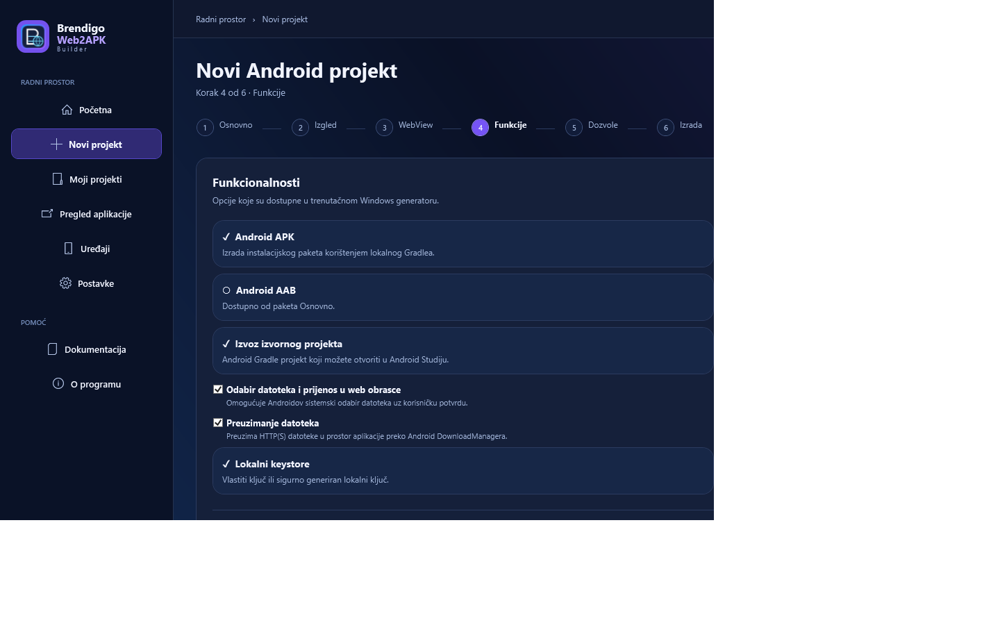

<h1>Brendigo Web2APK Builder</h1>
<strong>Nativni Windows Studio + Android Mobile klijent</strong>

🌐 Web → APK/AAB · 🎨 Napredni brending · 🔏 Lokalno potpisivanje · 🛡️ Kontrolirane dozvole

<a href="https://github.com/bren-wp/Web2APK-Builder/releases/latest">Preuzmi najnovije izdanje</a> · <a href="https://brendigo.com">brendigo.com</a> · <a href="SECURITY.md">Sigurnost</a>

---

## Windows Studio (.NET 10 / WPF)

Nativni Windows program za kreiranje i konfiguriranje Android WebView aplikacija i lokalnu izradu APK/AAB paketa uz Android SDK. Ne zahtijeva Electron ni Chromium. Prozor se ne pokreće maksimiziran i prilagođava se širini zaslona.

**Ključne značajke:** lokalno upravljanje projektima, HTTPS i offline HTML, tema i prilagodljive ikone, dinamički splash, kamera, mikrofon, približna lokacija, Android odabir i preuzimanje datoteka, AdMob banner s UMP korisničkim pristankom, Firebase Cloud Messaging i lokalno potpisivanje s vlastitim ili slučajno generiranim trajnim ključem.

### Stvarni nativni zasloni

Snimke se automatski stvaraju iz WPF renderera tijekom CI-ja, a ne umjetnim generiranjem:

| Početni zaslon | Novi projekt |
|---|---|
|  |  |
| Izgled i splash | AdMob i Firebase |
|  |  |
| Dozvole | Potpisivanje i izrada |
|  |  |

Ako screenshotovi još nisu prisutni, postupak snimanja nije potvrđen. **Pixel-perfect 1:1 podudaranje sa svim referencama još nije verificirano.**

## Android Mobile klijent

Projekt **android/** sadrži nativnu Android aplikaciju s Brendigo brendingom, početnim zaslonom, projektima, editorom, pregledom HTTPS sadržaja i lokalnim JSON uvozom/izvozom. Konfiguracije se mogu ručno prenositi u Windows Studio i obratno. Privatni ključevi i lozinke se ne prenose.

**Android Mobile ne kompajlira APK/AAB na telefonu.** Izradu generiranih Android paketa izvodi Windows Studio. AdMob i FCM opcije odnose se na generirane aplikacije i nisu oglasi ili obavijesti ugrađeni u sam Builder klijent.

## Izdanje i preuzimanje

| Paket | Namjena |
|---|---|
| **Brendigo-Web2APK-portable.exe** | Nativni Windows x64 bez instalacije |
| **Brendigo-Web2APK-Setup.exe** | Instalacijski program za Windows x64 |
| **Brendigo-Web2APK-Android-test.apk** | Testni Android klijent s debug potpisom; za testiranje |
| **Brendigo-Web2APK-Android-unsigned.aab** | Nepotpisani AAB; za produkciju potreban je vlastiti trajni ključ |

[GitHub izdanja](https://github.com/bren-wp/Web2APK-Builder/releases)

Windows EXE nije digitalno potpisan izdavačkim certifikatom. Debug Android potpis ne jamči nadogradnju u budućim izdanjima, a nepotpisani AAB nije spreman za Google Play.

## Kako izraditi aplikaciju

1. U Windows Studiju kliknite **Novi projekt** i unesite naziv, identifikator aplikacije i HTTPS URL ili HTML mapu.
2. Podesite temu, PNG launcher ikonu, splash, WebView i potrebne Android dozvole.
3. Za **AdMob** unesite stvarni App ID i Banner Unit ID; za **Firebase** odaberite vlastiti google-services.json sa zadanim Android package ID-jem.
4. Za potpis odaberite postojeći keystore ili kliknite **Generiraj novi slučajni ključ**. **Istog ključa i lozinke morate se držati u svim budućim ažuriranjima!**
5. Instalirajte JDK 17, Android SDK Platform 36 i Gradle 9.6+. Gradle je moguće instalirati kroz Studio uz privolu i SHA-256 provjeru.
6. Izradite APK/AAB, provjerite dozvole i rad na stvarnom Android uređaju te ispunite aktualna Google Play pravila.

**Stvarna dostava FCM poruka i prikaz AdMob oglasa zahtijevaju valjan Firebase odnosno AdMob račun, odgovarajuće konfiguracije, korisnički pristanak i testiranje.** Ove ovisnosti dolaze iz Googleova repozitorija i ne obrađuju se potpuno offline.

## Razvoj i testovi

Na Windowsu koristite .NET 10, a za Android JDK 17, SDK 36 i Gradle 9.6+.

Windows: dotnet run --project src/Brendigo.Web2APK.Windows/Brendigo.Web2APK.Windows.csproj

Testovi: dotnet run -c Release --project tests/Brendigo.Web2APK.Core.Tests/Brendigo.Web2APK.Core.Tests.csproj

Android: gradle -p android :app:assembleDebug :app:bundleRelease

Ikonica: powershell.exe -NoProfile -STA -ExecutionPolicy Bypass -File scripts/make-icon.ps1

Automatizacija: [Windows/Android Release](.github/workflows/windows-release.yml) · [Quality](.github/workflows/quality.yml).

## Status

Poboljšanja UI/UX-a i funkcionalna testiranja napreduju zaslon po zaslon. CI kompilacija ne jamči besprijekoran rad svih integracija na svim uređajima, niti su sve vizualne reference provjerene pixel po pixel. Pogledajte [CHANGELOG.md](CHANGELOG.md) i [SECURITY.md](SECURITY.md).

<strong>Brendigo · brendigo.com</strong>

