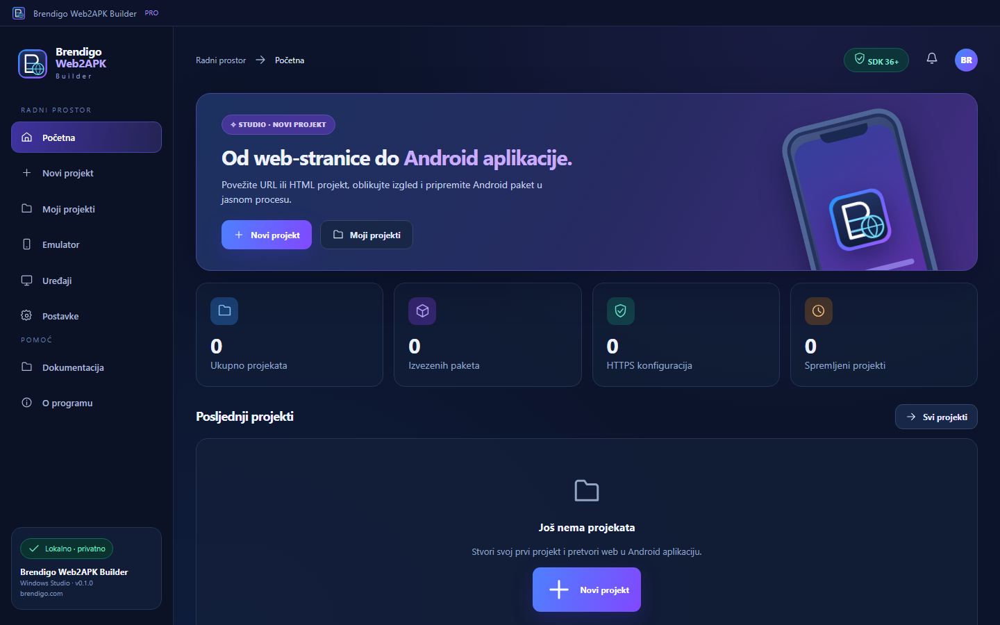
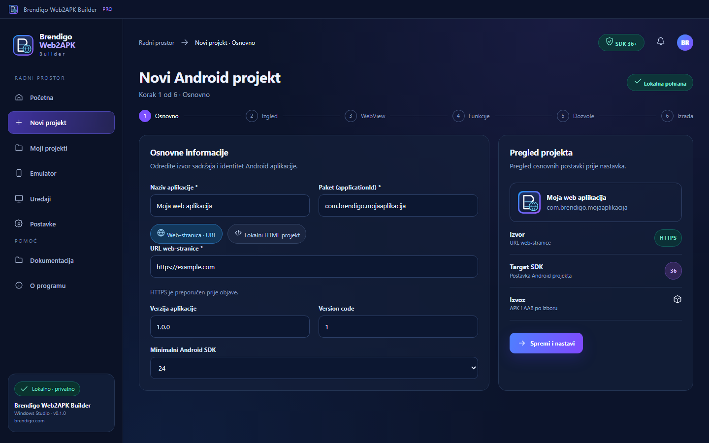
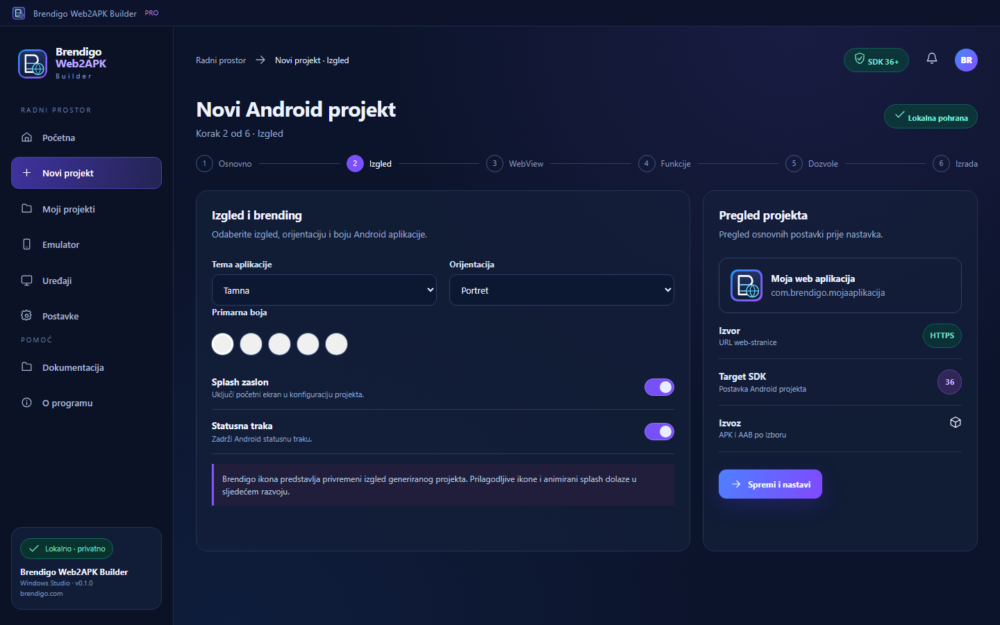
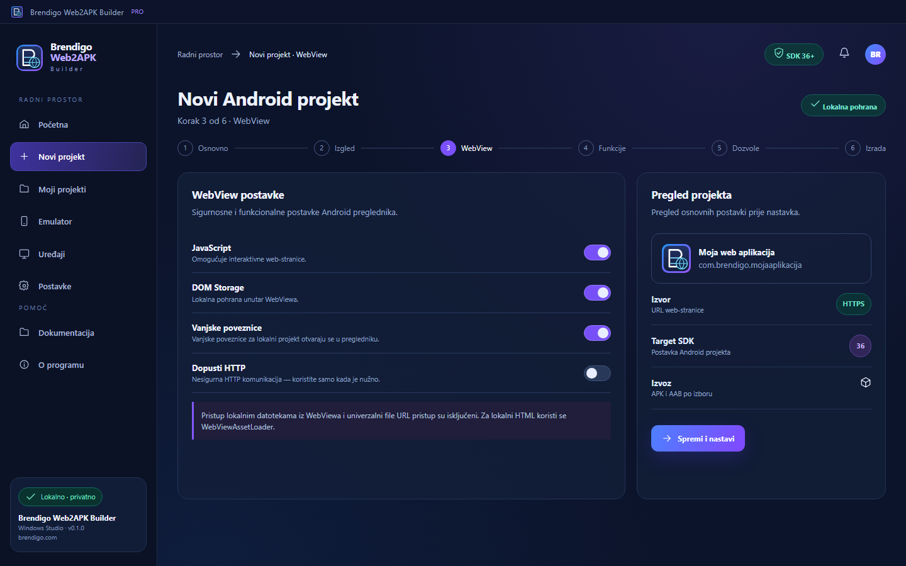
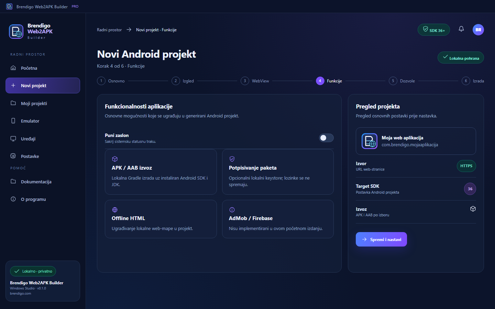
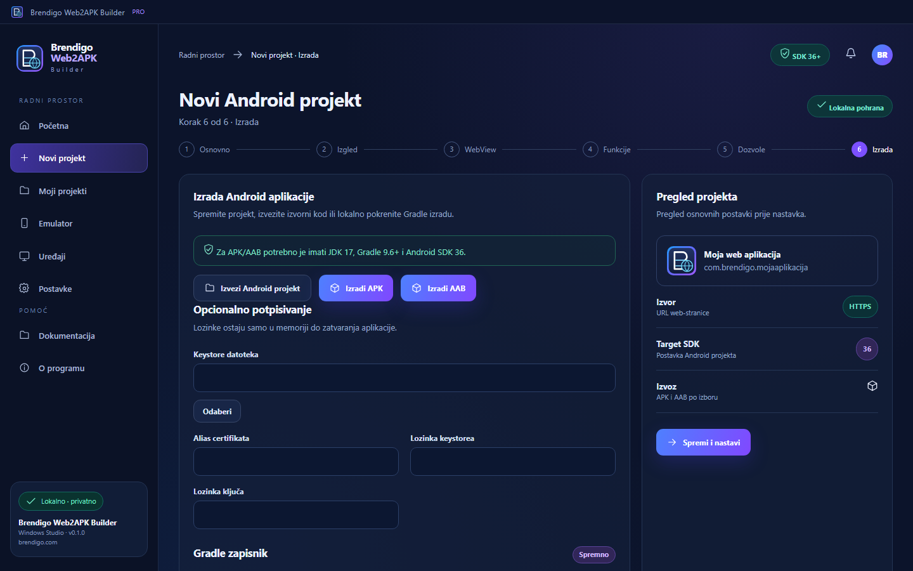

  
  <h1>BRENDIGO WEB2APK BUILDER</h1>
  
<b>Vaša web-stranica. Vaša Android aplikacija. Vaš Windows Studio.</b>

  
🖥️ Windows 10/11 · 🇭🇷 Hrvatski UI · 🔒 Lokalna obrada · 🛠️ Android SDK 36+

  

    <a href="https://github.com/bren-wp/Web2APK-Builder/releases/latest">⬇️ Preuzmi Windows aplikaciju</a>
    · <a href="https://brendigo.com">🌐 Brendigo.com</a>
    · <a href="SECURITY.md">🛡️ Sigurnost</a>
  

---

## 🚀 Od web-stranice do Android projekta

**Brendigo Web2APK Builder** je Windows Studio za pretvaranje HTTPS web-stranica i lokalnih HTML mapa u Android WebView projekte. Uređujte naziv i vizualni stil, identitet paketa, temu, postavke preglednika i dozvole, a zatim izvezite izvorni projekt ili lokalno izradite APK/AAB koristeći Android razvojne alate.

### 🖥️ Prikaz stvarnog Windows sučelja

Snimke ispod automatski nastaju u GitHub Actions pokretanjem **istog renderera koji koristi desktop aplikacija**. Nisu generativni mockupovi. Ako je novo izdanje tek objavljeno, pričekajte dovršetak koraka za snimanje u CI-ju.

| Početna ploča | Novi projekt |
| :---: | :---: |
|  |  |
| Izgled aplikacije | WebView postavke |
|  |  |
| Funkcionalnosti | Izrada APK/AAB |
|  |  |

### ✨ Ključne mogućnosti

- 📁 **Projektni centar** — spremanje i uređivanje projekata na računalu.
- 🌐 **URL i lokalni HTML** — podrška za HTTPS web-stranice ili index.html projekt u lokalnoj mapi.
- 🎨 **Izgled i identitet** — naziv aplikacije, package ID, orijentacija, boja, tema i verzije.
- 🧩 **Siguran WebView** — minimalne dozvole, HTTPS po zadanim postavkama i AndroidX WebViewAssetLoader za lokalni sadržaj.
- 📦 **APK i AAB** — stvarni Gradle build kada su JDK, Android SDK i Gradle dostupni.
- 🔐 **Potpisivanje** — podrška za vlastiti Android keystore bez spremanja lozinki.
- 🧰 **Razvojni alati** — provjera JDK/Gradle/ADB i lista povezanih Android uređaja.
- 🛡️ **Privatnost** — nema računa, vanjske telemetrije ni cloud pohrane projekta.

## ⬇️ Preuzimanje · dvije Windows verzije

| Datoteka u GitHub Releases | Opis |
| --- | --- |
| **Brendigo-Web2APK-portable.exe** | Prijenosna Windows x64 aplikacija; bez instalacije |
| **Brendigo-Web2APK-Setup.exe** | Windows x64 instalacija putem NSIS-a |

**[Najnovije izdanje i preuzimanja](https://github.com/bren-wp/Web2APK-Builder/releases)**

Obje datoteke automatski se pripremaju pri **svakoj novoj verziji**, uz obavezne testove i provjeru postojanja oba paketa. Neuspjela izrada ne označava se uspješnim izdanjem.

> Windows EXE trenutačno nije digitalno potpisan izdavačkim certifikatom te SmartScreen može prikazati upozorenje. To je odvojeno od Android keystore potpisivanja.

## 🛠️ Kako koristiti

1. Otvorite Windows Studio i kliknite **Novi projekt**.
2. Upišite naziv aplikacije, package ID i HTTPS adresu ili lokalni HTML folder koji sadrži index.html.
3. Podesite izgled, orijentaciju, verzije, WebView postavke i dozvole.
4. Odaberite **Izvezi Android projekt**, **Izradi APK** ili **Izradi AAB**.
5. Za kompajliranje morate zasebno instalirati **JDK 17**, **Gradle 9.6+**, **Android SDK Platform 36** i konfigurirati JAVA_HOME i ANDROID_HOME ili ANDROID_SDK_ROOT.
6. Za potpisanu Android distribuciju odaberite valjani keystore i unesite odgovarajuće podatke. Tajne se ne pohranjuju u projekt.

Bez keystorea Android release može biti **nepotpisan**. Takav APK nije automatski spreman za Google Play ni instalaciju. Za prvu Android izradu obično je potrebna mrežna veza za dohvat Gradle/AndroidX ovisnosti.

## 💻 Razvoj i pakiranje

Na Windowsu instalirajte Node.js 24 i pokrenite:

    git clone https://github.com/bren-wp/Web2APK-Builder.git
    cd Web2APK-Builder
    npm install
    npm start
    npm test
    npm run dist:win

CI konfiguracija: [Windows Build & Release](.github/workflows/windows-release.yml) i [Quality checks](.github/workflows/quality.yml). **Prije svake nove verzije povećajte verziju u package.json** kako se ne bi prepisalo prethodno GitHub izdanje.

## 🎨 Izvorni brending

Brending: **Brendigo** · web **brendigo.com**. Vizualni sustav temelji se na Midnight #090F21, Surface #121D39, Blue #3A86FF, Violet #854EFF i Cyan #31D4FF. Dizajn se razvija prema referentnim Windows zaslonima u osnovnoj rezoluciji 1440 × 900, ali u ovoj početnoj implementaciji **pixel-perfect 1:1 podudaranje svih 16 zaslona još nije verificirano**.

## 📋 Status i opseg

Ovo je **isključivo Windows aplikacija**. Android projekti koje izrađuje njezin generator nisu zaseban Brendigo Android klijent. AdMob, Firebase, napredne notifikacije, potpuno upravljanje kamerom, sve animacije i dinamičke ikone još nisu implementirane i neće se prikazivati kao gotove opcije. Program se dalje razvija zaslon po zaslon.

Detalji prvog izdanja: [CHANGELOG.md](CHANGELOG.md). Za sigurnost pogledajte [SECURITY.md](SECURITY.md).

---

 <b>Made by Brendigo</b> <a href="https://brendigo.com">brendigo.com</a>

